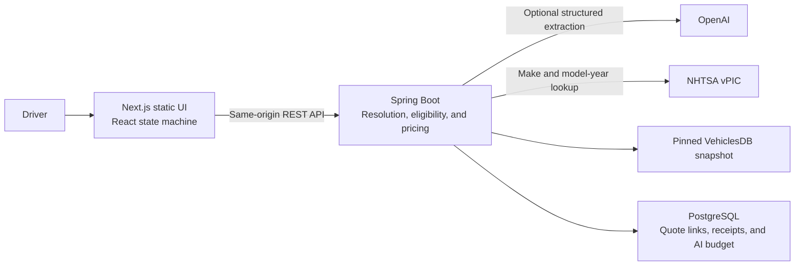

# Adaptive Quote

An automotive tuning quote demo built with Java 21, Spring Boot, PostgreSQL, Next.js, and TypeScript. Describe a vehicle and its modifications, review the parts the app found, and compare tune stages with prices calculated by Spring.

[Try the live demo](https://quote.dinhjdev.com/) · [Embedded demo](https://quote.dinhjdev.com/embedded) · [OpenAPI contract](contracts/openapi.yaml)

This independent portfolio project uses public vehicle reference data, fictional contact details, and synthetic prices. Checkout is simulated.

## Try it in a minute

1. Enter `2022 86 with BC Coilovers and an Apex'i Single Exit Exhaust`. The app resolves the vehicle to a Toyota GR86 and groups the coilovers and exhaust separately.
2. Add **Intake** with a quick-select tag, review the categorized parts, and continue past the fictional contact.
3. On **Quote Ready**, copy the link or open checkout. The recommended stage starts selected. Switch stages to see Spring recalculate the total.
4. Open the copied link in another browser to see the exact build and original recommendation. Save a receipt from checkout to keep the selected services and total.

Try `86 with an exhaust` to see a clarification step, or enter a classic vehicle manually to see the custom-pricing path.

## Architecture



- **Workflow.** A TypeScript reducer manages clarification, edits, and browser Back and Forward. Changes to vehicle or modification selections invalidate stale quote totals. Both layouts use the same flow.
- **Extraction.** OpenAI extracts candidate identities and part names with evidence. Spring validates the response, resolves Toyota 86 shorthand using the stated year, and checks eligible U.S. candidates against vPIC before consulting the pinned VehiclesDB snapshot. The app can use catalog matching or manual entry when live extraction is unavailable.
- **Pricing.** Spring recommends a stage and calculates prices from confirmed vehicle and modification categories. Unverified vehicles and complex builds can continue to custom pricing. The [OpenAPI contract](contracts/openapi.yaml) generates the frontend types.
- **Storage.** PostgreSQL holds seven-day Quote Ready snapshots and immutable receipts. Anyone with a share link can see the saved build summary. Receipts are scoped to the browser session, and replaying a save with the same quote ID returns the original receipt. Drafts are stored in the browser.
- **Deployment.** Railway runs Spring Boot and the statically built Next.js frontend in one container. Flyway applies schema migrations. PostgreSQL also tracks the live extraction budget across app instances.

## Run locally

Requires Java 21, Node.js 22, and Docker for the development database.

```sh
docker compose up -d postgres
cd frontend
npm ci
npm run build
cd ../backend
./mvnw -B -Pweb package
java -jar target/adaptive-quote.jar
```

On Windows, use `.\mvnw.cmd -B -Pweb package`. Open [the standalone flow](http://localhost:8080) or [the embedded flow](http://localhost:8080/embedded). The default catalog works without an API key. See [example environment variables](.env.example) for local overrides and [Railway setup](docs/railway-preview.md) for hosting and optional live extraction.

## Testing

- From `frontend`, run `npm run check` for lint, TypeScript, and workflow tests.
- From `backend`, run `./mvnw verify` for Spring MVC and PostgreSQL integration tests. The integration tests use Testcontainers by default. For a dedicated local test database, set `QUOTE_TEST_DB_URL`, `QUOTE_TEST_DB_USER`, and `QUOTE_TEST_DB_PASSWORD`.
- After packaging with the `web` profile, run `npx playwright install chromium` and `npm run test:e2e` from `frontend`. The browser suite starts the packaged Spring app and covers adaptive intake, live repricing, cross-browser quote links, and save recovery.

[GitHub Actions](.github/workflows/ci.yml) runs the checks on pull requests and pushes to `main`.

## Vehicle data

Vehicle data by [VehiclesDB](https://vehiclesdb.com), licensed under [CC BY 4.0](https://creativecommons.org/licenses/by/4.0/). The bundled [2026.11.10 release](https://github.com/vehiclesdb/vehiclesdb/releases/tag/v2026.11.10) is filtered to car, van, and truck nameplates, aliases, and recorded years. See the [upstream attribution notices](frontend/public/vehicle-data-attribution.md). The [import script](scripts/import-vehiclesdb.py) verifies the source CSV checksum before regenerating the snapshot.

## License

Application code is available under the [MIT License](LICENSE).
